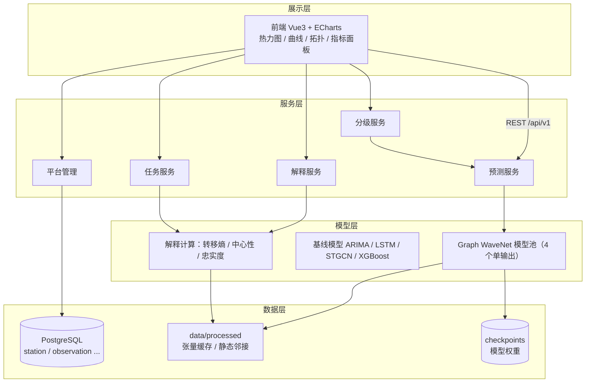
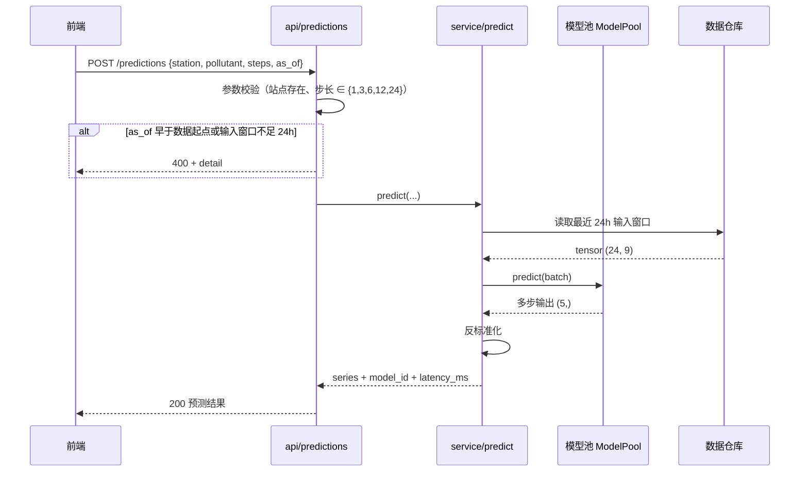
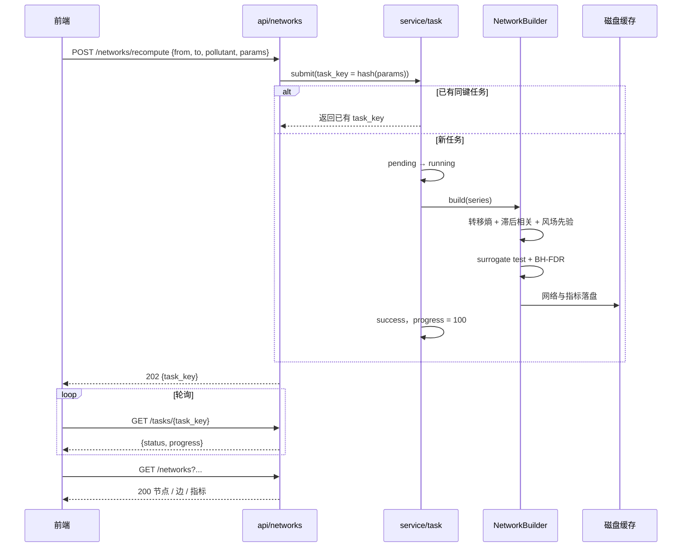
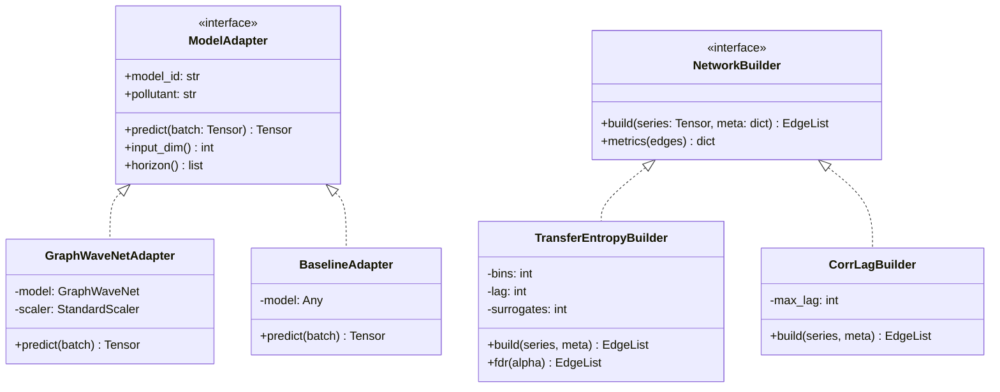

# 概要设计说明书

> 对应开题报告第五章技术路线、3.3（2）架构与接口设计。状态：已完成，含架构图、两张时序图与适配器类图（Mermaid）。

## 1 架构总览

系统采用前后端分离的 B/S 架构，整体为模块化单体（不拆微服务）。

**系统级四层**：数据层 → 模型层 → 服务层 → 展示层（贯穿工程实践线）。

**后端包级结构**：

```
api/        路由与参数校验（不含业务计算）
service/    用例编排（预测、解释、任务调度）
domain/     纯计算（预处理、指标、网络统计、忠实度）
infra/      模型加载、数据库、缓存
```

> 两套分层的对应关系：数据层 → infra + scripts；模型层 → domain/model；服务层 → api + service；展示层 → 前端工程。

## 2 模块划分

| 模块 | 职责 | 对外接口 |
| --- | --- | --- |
| 数据预处理 | 清洗、对齐、特征构造、质量自检 | 离线脚本 + 数据集版本表 |
| 预测服务 | 4 个单输出模型在线推理 | `/api/v1/predictions` |
| 解释服务 | 网络构建、一致性指标、忠实度、溯源、遴选 | `/api/v1/networks`、`/api/v1/trace` |
| 分级服务 | 依 GB 3095 二级限值分级 | `/api/v1/grading` |
| 任务服务 | 异步重算、状态与进度 | `/api/v1/tasks` |
| 平台管理 | 数据与模型版本、日志 | `/api/v1/datasets`、`/api/v1/models` |

## 3 关键设计决策

1. **包边界**：路由层不出现数值计算代码，计算逻辑下沉为可单测纯函数。
2. **两个适配器接口**：
   - `ModelAdapter.predict(batch) -> Tensor`：统一 Graph WaveNet 与各基线；
   - `NetworkBuilder.build(series) -> edges`：统一转移熵与相关系数等实现。
3. **批量推理与幂等任务**：30 站点拼为一个批次一次前向；任务唯一键 = hash(站点范围 + 时间窗 + 污染物 + 算法参数)，状态机 pending → running → success/failed。
4. **前端单一状态源**：全局状态（站点、污染物、时间窗、步长）+ 视图只订阅；筛选状态写入 URL。

## 4 三类 AI 服务

| 服务 | 输入 | 输出 | 处理 |
| --- | --- | --- | --- |
| 预测 | 站点、污染物、步长 | 多步浓度（可选区间） | 在线同步 |
| 解释 | 站点或全局 | 网络、关键站点、忠实度 | 异步重算 + 缓存 |
| 分级 | 预测浓度 | 分级结果 | 在线实时 |

## 5 部署拓扑

```
[浏览器] → [前端静态资源] → [FastAPI 服务] → [PostgreSQL]
                                  ↓
                          [模型权重（卷挂载）]
```

Docker Compose 编排 web / api / db 三个服务，模型权重与配置文件以卷挂载。

## 6 技术选型

| 层 | 选型 | 理由 |
| --- | --- | --- |
| 模型 | PyTorch 2.x | 生态成熟，官方实现可直接二次开发 |
| 后端 | FastAPI | 自动生成 OpenAPI，契合契约先行 |
| 前端 | React/Vue3 + ECharts | 图表生态完善，便于多视图联动 |
| 数据库 | PostgreSQL | 分区与 JSON 字段支持好 |
| 部署 | Docker Compose | 单机一键重建，满足可复现要求 |

## 7 设计图

### 7.1 系统架构图



### 7.2 时序图：一次预测请求



### 7.3 时序图：一次关联网络重算



### 7.4 类图：ModelAdapter 与 NetworkBuilder



## 8 完成情况

- [x] 架构图 — 见 7.1
- [x] 时序图（一次预测、一次重算）— 见 7.2、7.3
- [x] 类图（ModelAdapter / NetworkBuilder）— 见 7.4
