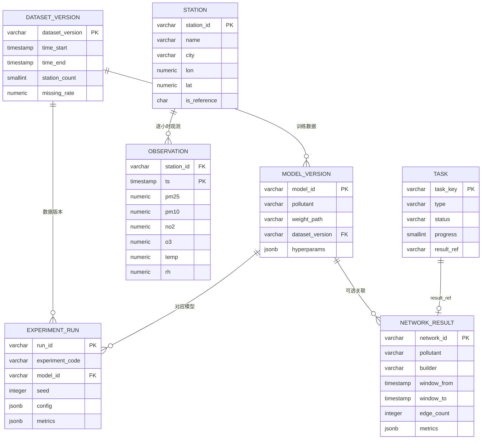

# 数据库设计说明书

> 对应开题报告 3.3（3）数据设计。状态：已完成，字段与 `scripts/init_db.sql` 一致。

## 1 ER 概述

版本追溯链：`dataset_version` → `model_version` → `experiment_run` → `network_result`

辅助表：`station`、`observation`、`task`

## 2 表清单

| 表名 | 用途 | 预估规模 |
| --- | --- | --- |
| station | 站点基础信息与坐标 | 24 行 |
| observation | 逐小时观测（按年分区） | 24 × 35064 ≈ 84 万行 |
| dataset_version | 数据集版本登记 | 十位数量级 |
| model_version | 模型权重与训练信息 | 十位数量级 |
| experiment_run | 实验记录（超参、种子、指标） | 百位数量级 |
| network_result | 关联网络结果与指标 | 百位数量级 |
| task | 异步任务状态与进度 | 百位数量级 |

## 3 字段设计

### 3.1 station

| 字段 | 类型 | 约束 | 说明 |
| --- | --- | --- | --- |
| station_id | varchar(32) | PK | 站点编号 |
| name | varchar(64) | NOT NULL | 站点名称 |
| city | varchar(32) | | 所属城市 |
| lon | numeric(9,6) | NOT NULL | 经度 |
| lat | numeric(9,6) | NOT NULL | 纬度 |
| is_reference | char(1) | NOT NULL DEFAULT 'N' | 是否对照点（Y/N），仅 1002A 为 Y |

### 3.2 observation

| 字段 | 类型 | 约束 | 说明 |
| --- | --- | --- | --- |
| station_id | varchar(32) | FK, 复合 PK | 站点 |
| ts | timestamp | 复合 PK | 整点时间 |
| pm25 / pm10 / no2 / o3 | numeric(8,3) | | 污染物浓度 |
| temp / rh / ws / wd / pres | numeric(8,3) | | 气象要素 |

> 按年分区（`PARTITION BY RANGE (ts)`），唯一索引 `(station_id, ts)`。

### 3.3 task

| 字段 | 类型 | 说明 |
| --- | --- | --- |
| task_key | varchar(64) | PK，参数哈希，幂等键 |
| type | varchar(32) | network / trace / train |
| params | jsonb | 参数快照 |
| status | varchar(16) | pending / running / success / failed |
| progress | smallint | 0–100 |
| result_ref | varchar(128) | 结果表或文件引用 |
| created_at / finished_at | timestamp | 时间戳 |

### 3.4 model_version

| 字段 | 类型 | 说明 |
| --- | --- | --- |
| model_id | varchar(64) | PK |
| pollutant | varchar(16) | PM2.5 / PM10 / NO2 / O3 |
| weight_path | varchar(256) | 权重文件路径 |
| dataset_version | varchar(64) | FK → dataset_version |
| trained_at | timestamp | 训练完成时间 |

补充字段：`model_type`（gwnet / stgcn / lstm / xgboost / arima）、`hyperparams`（jsonb，训练超参快照）、`note`。

### 3.5 dataset_version

| 字段 | 类型 | 约束 | 说明 |
| --- | --- | --- | --- |
| dataset_version | varchar(64) | PK | 版本号，形如 `ds-2021-2024-v1` |
| name | varchar(128) | NOT NULL | 数据集名称 |
| source | varchar(256) | NOT NULL | 数据来源与文件模式（china_sites + ERA5-Land） |
| time_start / time_end | timestamp | NOT NULL | 覆盖时段 |
| station_count | smallint | NOT NULL | 站点数（当前 24） |
| pollutant_list | text[] | NOT NULL | 建模污染物（pm25/pm10/no2/o3） |
| missing_rate | numeric(6,4) | | 总体缺失率（当前 0.1155） |
| checksum | varchar(128) | | 产物校验和，用于复现比对 |
| created_at | timestamp | NOT NULL | 登记时间 |
| note | text | | 备注（清洗规则、异常站点处理） |

### 3.6 experiment_run

| 字段 | 类型 | 约束 | 说明 |
| --- | --- | --- | --- |
| run_id | varchar(128) | PK | `{日期}-{模型}-{污染物}-{种子}` |
| experiment_code | varchar(8) | NOT NULL | E1–E7 |
| model_id | varchar(64) | FK → model_version | 对应模型版本 |
| pollutant | varchar(16) | NOT NULL | pm25 / pm10 / no2 / o3 |
| seed | integer | NOT NULL | 随机种子 |
| dataset_version | varchar(64) | FK → dataset_version | 数据版本 |
| config | jsonb | NOT NULL | 完整超参与数据版本快照 |
| metrics | jsonb | NOT NULL | 分步长 MAE / RMSE / MAPE / R² |
| best_epoch | smallint | | 验证集最优轮次 |
| duration_s | integer | | 训练耗时（秒） |
| status | varchar(16) | NOT NULL | success / failed |
| started_at / finished_at | timestamp | | 起止时间 |
| note | text | | 复现说明与特殊配置 |

### 3.7 network_result

| 字段 | 类型 | 说明 |
| --- | --- | --- |
| network_id | varchar(64) | PK，参数哈希 |
| pollutant | varchar(16) | 污染物 |
| builder | varchar(32) | te_fusion / corr_lag |
| window_from / window_to | timestamp | 构建窗口 |
| params | jsonb | 分箱、滞后、surrogate 次数等 |
| dataset_version | varchar(64) | FK → dataset_version |
| edge_count / fdr_pass | integer | 总边数 / 通过 FDR 的边数 |
| modularity | numeric(8,5) | 模块度 |
| metrics | jsonb | 中心性、一致性指标等 |
| storage_path | varchar(256) | 结果文件路径 |
| created_at | timestamp | 生成时间 |

## 4 索引与分区

- `observation`：按年 RANGE 分区，索引 `(station_id, ts)`、`(ts)`；
- `experiment_run`：索引 `(model_id)`、`(experiment_code)`、`(pollutant, seed)`；
- `task`：索引 `(status)`、`(type)`。

## 5 ER 图

## 6 完成情况

- [x] ER 图 — 见 §5（Mermaid）
- [x] 建表 SQL 与迁移脚本 — 已提供 `scripts/init_db.sql`（含年度分区、索引与数据集版本种子）
- [x] dataset_version 与 experiment_run 字段细化 — 见 §3.5、§3.6
