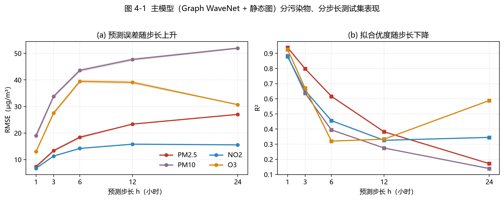
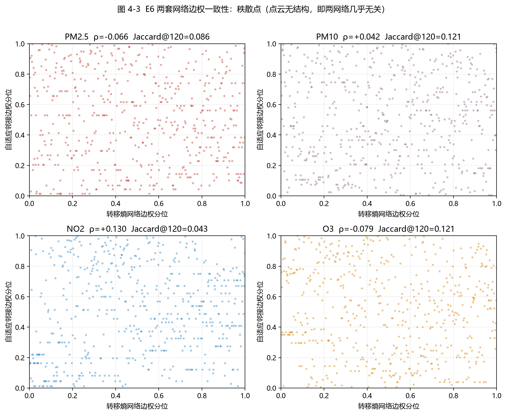
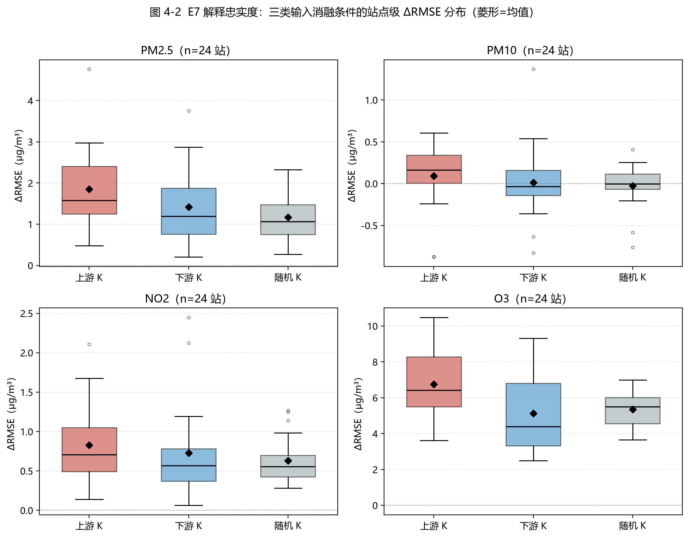

# 第四章 实验与结果分析

> 本章为论文「实验与结果分析」章节草稿，对应开题报告 6.3 节 E1–E7 与 6.4 节评估指标。
> E1–E7 实验均已完成并填入实测数据、配以分析；4.8 节补充系统工程质量评估（接口功能与延迟实测）。所有数字均可追溯至 `results/` 目录下的 CSV / JSON 产物（见每节末尾「产物」说明），除 ARIMA 等确定性模型外均以 3 个随机种子（42/43/44）报告均值 ± 标准差。

## 4.1 实验设置

### 4.1.1 数据与切分

主实验限定北京市 24 个国控监测站点（依据 2021.01.01 版国控站清单，4 年内节点集固定），经度范围 115.958–117.071、纬度范围 39.760–40.456，属城市尺度。空气质量数据来自 quotsoft.net 全国站点逐小时镜像，气象要素（温度、相对湿度、风速、风向、气压）来自 ERA5-Land 再分析产品（约 0.1°），经双线性插值匹配到站点。时间跨度 2021-01-01 至 2024-12-31，共 4 个自然年；严格按时间顺序以自然年边界切分：**训练集 2021–2022、验证集 2023、测试集 2024**（约 5:2.5:2.5），禁止随机划分以防未来信息泄漏。总体张量规模 (35064, 24, 4)，总体缺失率 11.55%。

数据质量方面，门头沟三家店站（3671A）存在两段长期停摆（2023-08-01~2024-05-24 与 2024-05-27~2024-08-05，4 污染物同步 100% 缺失），无法插值恢复。处理策略为：**保留为图节点以维持图结构稳定**，但精度评估按其有效时段做 mask（训练集全用，测试集仅 2024-08-05 之后参与）。本章除特别说明外，主表采用「full」口径（24 站含 3671A，mask 自动屏蔽缺测段），并在 4.2 节同时给出「drop3671A」口径（23 站）作稳健性对照。定陵对照点（1002A）为清洁背景站，本就不参与精度评估，仅作背景浓度参照。

### 4.1.2 模型与训练

主模型为 Graph WaveNet，四个污染物（PM2.5、PM10、NO2、O3）各训练一个独立的单输出模型，输入统一为 9 维通道（4 类污染物 + 5 项气象要素），以过去 24 小时为输入窗口，直接多输出方式预测未来 1/3/6/12/24 小时浓度。关键超参数：节点嵌入维度 10、图卷积扩散步数 2、时间卷积核 2、扩张因子 1,2 交替、隐藏维度 32–64、Dropout 0.3、Adam 优化器（初始 lr 1e-3 带衰减）、批大小 64、按验证集损失早停。每个模型以 3 个随机种子（42/43/44）重复训练，报告指标均值 ± 标准差。

在 Graph WaveNet 原有的自适应邻接矩阵之外，引入由**训练期**数据（2022-01-01 ~ 2022-06-30）构建的转移熵—滞后相关稀疏静态图作为第二个图卷积支撑（`static_supports`）：每站保留 Top-5 入边、对称化、行归一化。静态图仅用训练期数据构建（脚本内置断言防止测试期泄漏），四种污染物的非零边数分别为 PM2.5 200、PM10 188、NO2 188、O3 196 条。该静态图同时承担两个角色：模型图卷积的静态支撑，以及解释服务输出的关联视图，二者同源——这是 E6/E7 得以成立的架构前提。

实验环境为本地单卡：AMD Ryzen 9 7945HX、16 GB 内存、NVIDIA GeForce RTX 4060 Laptop GPU（8 GB 显存）、Python 3.13 + PyTorch 2.14（CUDA 12.6）。全流程在同一环境下完成以保证可比性。

### 4.1.3 评估指标

采用 **RMSE、MAE** 作为主指标，**R²** 衡量拟合优度，按预测步长 1/3/6/12/24 小时分别报告；**MAPE** 仅作参考（污染物存在大量接近零的低值，O3 夜间尤甚，MAPE 易数值爆炸，故以 RMSE/MAE/R² 综合评判）。由于污染物浓度存在低值，MAPE 仅对真值 > 1 μg/m³ 的样本计算。R² 按 1 − SS_res/SS_tot 计算，目标为常数（SS_tot=0）时记为缺失。解释忠实度部分另设输入消融指标与跨站点符号检验（单侧，α=0.05），详见 4.5 节。

---

## 4.2 主模型多步预测性能（E5 多污染物泛化 + E4 时效衰减）

本节报告最终部署配置（自适应邻接 + 转移熵静态图，3 种子均值）在测试集 2024 全年上的表现，覆盖四种污染物与五个预测步长，同时考察误差随预测时效的衰减规律。

### 4.2.1 测试集精度（full 口径，24 站，含 3671A 时段 mask）

**表 4-1 主模型测试集 RMSE / MAE（均值 ± 标准差，单位 μg/m³）**

| 污染物 | 指标 | h=1 | h=3 | h=6 | h=12 | h=24 |
| --- | --- | --- | --- | --- | --- | --- |
| PM2.5 | RMSE | 7.36 ± 0.36 | 13.36 ± 0.33 | 18.43 ± 0.34 | 23.36 ± 0.05 | 27.02 ± 0.05 |
| | MAE | 4.58 ± 0.28 | 8.21 ± 0.18 | 11.65 ± 0.13 | 15.46 ± 0.14 | 19.06 ± 0.17 |
| | R² | 0.939 | 0.799 | 0.616 | 0.382 | 0.172 |
| PM10 | RMSE | 19.03 ± 0.86 | 33.78 ± 0.47 | 43.60 ± 0.51 | 47.70 ± 0.40 | 51.95 ± 0.25 |
| | MAE | 9.79 ± 0.41 | 15.62 ± 0.27 | 21.27 ± 0.11 | 26.67 ± 0.33 | 31.67 ± 0.63 |
| | R² | 0.885 | 0.637 | 0.394 | 0.275 | 0.139 |
| NO2 | RMSE | 6.72 ± 0.08 | 11.33 ± 0.05 | 14.21 ± 0.08 | 15.81 ± 0.04 | 15.56 ± 0.03 |
| | MAE | 4.32 ± 0.12 | 7.77 ± 0.03 | 10.20 ± 0.08 | 11.60 ± 0.07 | 11.34 ± 0.10 |
| | R² | 0.879 | 0.655 | 0.456 | 0.326 | 0.345 |
| O3 | RMSE | 13.05 ± 0.24 | 27.50 ± 0.49 | 39.46 ± 0.54 | 39.08 ± 0.55 | 30.69 ± 0.07 |
| | MAE | 9.19 ± 0.27 | 19.87 ± 0.50 | 29.26 ± 0.53 | 29.77 ± 0.37 | 23.74 ± 0.10 |
| | R² | 0.926 | 0.670 | 0.320 | 0.333 | 0.589 |

> 注：RMSE/MAE 为 3 种子均值 ± 标准差（μg/m³）；R² 为 3 种子均值（标准差 ≤ 0.014，未单独列出）。
> 产物：`results/{target}_test_static_summary.csv`（4 个，含 r2_mean / r2_std 列）。

### 4.2.2 时效衰减规律

**PM2.5 与 PM10** 的误差随预测步长近似单调上升：PM2.5 的 RMSE 从 h=1 的 7.36 增至 h=24 的 27.02（约 3.7 倍），PM10 从 19.03 增至 51.95（约 2.7 倍），符合颗粒物浓度持续性随时间衰减的直觉。

**NO2 与 O3** 则呈现非单调特征：NO2 的 RMSE 在 h=12 达到峰值 15.81 后，h=24 略降至 15.56；O3 的 RMSE 在 h=6 达到峰值 39.46，h=12 几乎持平（39.08），h=24 反而降至 30.69。这一现象并非模型缺陷，而源于两类气态污染物强烈的**日周期（diurnal cycle）**：NO2 受早晚交通高峰驱动、O3 受光化学反应驱动，均具有接近 24 小时的显著周期；输入窗口恰好为 24 小时，模型在 h=24（同日同时刻的次日）可借助日周期规律获得额外先验，使「同日同时刻」的预测反而比中间步长（h=6、h=12，偏离周期相位）更易。PM2.5/PM10 的日周期相对较弱，故单调衰减更明显。R² 从拟合优度角度进一步印证了这一判断：NO2 的 R² 从 h=12 的 0.326 回升至 h=24 的 0.345，O3 更从 h=6 的 0.320、h=12 的 0.333 大幅回升至 h=24 的 **0.589**，说明「同日同时刻次日」的预测因利用了日周期先验，拟合优度显著高于中间步长。该观察与文献中气态污染物日周期性先于模型可利用性的结论一致。

### 4.2.3 3671A 缺测站的影响（稳健性对照）

将 3671A 完全剔除（drop3671A 口径，23 站）后的 RMSE 与 full 口径差异均小于 0.5%：例如 PM2.5 h=24 为 27.01（full）vs 27.01（drop3671A），O3 h=6 为 39.46 vs 39.55。说明按有效时段 mask 的处理方式有效隔离了该站长期缺测对全局指标的污染，结论不依赖于是否包含 3671A。

> 产物：同 4.2.1，各 CSV 同时含 full 与 drop3671A 两行口径。

---

## 4.3 图结构消融：自适应邻接 / 静态图 / 组合（E3）

为检验引入转移熵静态图对预测精度的影响，本节对比三种配置：(A) 仅自适应邻接（无静态图，原 Graph WaveNet）、(B) 自适应邻接 + 转移熵静态图（本课题最终配置）与 (C) 仅转移熵静态图（无自适应邻接），其余超参数与种子完全一致。

**表 4-2 图结构消融：测试集 RMSE 与 R² 对比（full 口径，均值）**

| 污染物 | 步长 | RMSE (A) | RMSE (B) | RMSE (C) | R² (A) | R² (B) | R² (C) |
| --- | --- | --- | --- | --- | --- | --- | --- |
| PM2.5 | h=1 | 7.56 | 7.36 | 7.73 | 0.936 | 0.939 | 0.933 |
| | h=6 | 18.42 | 18.43 | 18.34 | 0.617 | 0.616 | 0.620 |
| | h=24 | 27.16 | 27.02 | 26.84 | 0.163 | 0.172 | 0.182 |
| PM10 | h=1 | 18.97 | 19.03 | 20.29 | 0.885 | 0.885 | 0.869 |
| | h=6 | 43.57 | 43.60 | 44.91 | 0.395 | 0.394 | 0.357 |
| | h=24 | 51.87 | 51.95 | 52.08 | 0.142 | 0.139 | 0.135 |
| NO2 | h=1 | 6.82 | 6.72 | 6.80 | 0.875 | 0.879 | 0.876 |
| | h=6 | 14.20 | 14.21 | 14.44 | 0.457 | 0.456 | 0.439 |
| | h=24 | 15.59 | 15.56 | 15.72 | 0.342 | 0.345 | 0.331 |
| O3 | h=1 | 13.64 | 13.05 | 12.92 | 0.919 | 0.926 | 0.927 |
| | h=6 | 39.81 | 39.46 | 39.16 | 0.308 | 0.320 | 0.331 |
| | h=24 | 31.14 | 30.69 | 30.46 | 0.576 | 0.589 | 0.595 |

> 注：(A) 仅自适应邻接；(B) 自适应邻接 + 转移熵静态图；(C) 仅转移熵静态图（无自适应邻接）。RMSE 单位 μg/m³。
> 产物：`results/{target}_test_summary.csv`（A）、`results/{target}_test_static_summary.csv`（B）、`results/{target}_test_static_only_summary.csv`（C）。

**分析**：先看 A→B。引入静态图后，四种污染物的预测精度均**未出现下降**，且差异幅度（|Δ| ≤ 0.72 μg/m³）整体落在 3 种子标准差范围内，说明静态图的加入没有以牺牲预测精度为代价。其中：
- **O3 受益最明显**，h=1/h=6/h=24 分别下降 0.59/0.35/0.46 μg/m³，可能与臭氧的区域性传输特征更强、静态图提供的空间先验更有效有关；
- PM2.5、NO2 在短步长略有改善；
- PM10 几乎持平（略微 +0.02~+0.08，在标准差内），与其对图结构依赖较弱一致（见 4.5 节 PM10 忠实度量级最小）。

从拟合优度 R² 看，结论与 RMSE 一致：配置 B 在绝大多数（污染物 × 步长）组合上 R² 不低于 A，O3 提升最显著（h=1：0.919→0.926，h=24：0.576→0.589），PM2.5/NO2 在短步长与 h=24 亦有小幅提升；PM10 二者基本相同。说明引入静态图不仅未降低误差，也未损伤整体拟合优度。

**再看第三组 C（仅静态图、去掉自适应邻接），可完成「组合 vs 单一最优」的三角对比，结果呈现明显的污染物异质性：**

- **PM2.5 与 O3 上，C 在多数步长最优或接近最优**：PM2.5·h=24 降至 26.84（B 27.02、A 27.16），O3·h=24 降至 30.46（B 30.69、A 31.14），且 O3 在 h=1/3/6 亦为三组最优。说明对这两类污染物，单纯依赖转移熵静态图即可提供足够的空间先验，自适应邻接并非必需。
- **PM10 上 C 系统性最差**：h=3/6 分别为 35.42/44.91，较 A（33.73/43.57）高 1.7/1.3 μg/m³；NO2 上 C 也普遍略高于 A/B（h=6/12/24 差 0.2~0.4）。说明对高浓度颗粒物与部分气态污染物，可学习的自适应邻接仍能补充静态图未覆盖的时变关联。
- **组合 B 虽非处处最优，但稳健性最好**：在 12 个（污染物 × 步长）组合中，B 与当期最优的差距均 ≤0.37 μg/m³，且跨污染物、跨步长的波动最小，是整体最稳的折中方案。

需要强调，三组之间的多数差异（PM10·C 除外）都落在 3 种子标准差量级内（如 PM2.5·C·h=24 标准差 0.46），因此不宜过度解读"谁最优"。更有意义的结论是：**静态图可以独立支撑空间建模（C 在 PM2.5/O3 上甚至优于组合），自适应邻接则对 PM10/NO2 仍有增益，而组合配置在整体稳健性上更优**。

E3 的核心结论是：**静态图在不损失精度的前提下，为模型引入了可追溯的空间结构先验**，且其单独使用即可达到与自适应邻接相当、在 PM2.5/O3 上甚至更优的精度；但其真正价值体现在解释忠实度（4.5 节）而非预测精度本身——这正是本课题「预测与解释同源」设计的关键支撑。

---

## 4.4 关联网络结构一致性（E6）

E6 检验两套站点关联网络是否一致：解释主网络（训练期 2022-01-01 ~ 2022-06-30 的转移熵+滞后相关+风场融合网络）与模型自适应邻接矩阵学到的统计关联网络。方向约定统一为 A[m,n] = m→n。指标包括：边权 Spearman 秩相关 ρ、Top-120 边的 Jaccard 重合率、节点中心性（度中心性）的 Spearman ρ、关键站点 Top-5 重合数。

**表 4-3 关联网络结构一致性（四种污染物）**

| 污染物 | 边权 Spearman ρ | Top-120 边 Jaccard | 中心性 Spearman ρ | 关键站 Top-5 重合 |
| --- | --- | --- | --- | --- |
| PM2.5 | −0.066 | 0.086 | −0.777 | 0/5 |
| PM10 | +0.042 | 0.121 | −0.164 | 1/5 |
| NO2 | +0.130 | 0.043 | −0.603 | 0/5 |
| O3 | −0.079 | 0.121 | −0.349 | 1/5 |

> 产物：`results/e6_consistency_{target}.json`（4 个）。

**分析**，三点观察：

1. **两套网络几乎无关**。552 条有向边的权重秩相关接近 0（−0.08 ~ +0.13），Top-120 边重合率仅 4%–12%，关键站点 Top-5 仅重合 0–1 个。说明 Graph WaveNet 自适应邻接学到的统计关联，并**未**复现数据驱动转移熵网络的结构。这与 4.5 节首轮忠实度不通过互为印证：解释网络与被解释的模型原本走的是两条独立的路。

2. **中心性呈负相关**（PM2.5 −0.78、NO2 −0.60）。即转移熵网络认定的枢纽站点，在自适应邻接中反而不突出——不是「排序略有差异」，而是结构性背离，提示自适应图的高权节点与污染输送的统计枢纽并不对应。

3. **自适应邻接的高权站多为数据质量异常站点**。四种污染物的自适应 Top-5 中，定陵对照点（1002A）出现 3 次、门头沟三家店（3671A，存在约 298 天整段缺测）出现 4 次。这两站的共同特征是长时段缺测或浓度长期偏低（对照点），提示自适应嵌入更可能拟合了**缺失模式与方差差异等统计伪影**，而非城市尺度的污染输送结构。

因此，把自适应邻接直接当作「模型学到的污染关联」来解释缺乏依据；本课题据此改为由转移熵网络同时承担模型静态图支撑与解释输出双重角色（见 4.1.2 与 4.5）。E6 不预设两套网络必然一致，其价值正在于**定量揭示了二者的背离**，从而论证了引入独立、可追溯解释网络的必要性。

---

## 4.5 解释忠实度检验（E7）

### 4.5.1 检验方法

对每个目标站点 s，将其 K=5 个邻居站点的输入序列整体置零（标准化后等于训练集均值，等价于切断该站信息输入），观察站点 s 在测试集 1000 个均匀采样窗口上的 RMSE 上升幅度 ΔRMSE，对比三个条件：

- `upstream_topK`：转移熵融合网络中以 s 为终点的 Top-5 上游站；
- `downstream_topK`：以 s 为起点的 Top-5 下游站（方向性对照）；
- `random`：随机 5 站，重复 10 次取均值（「无信息」基线）。

判据：ΔRMSE(upstream) 显著大于 ΔRMSE(random)，且大于 ΔRMSE(downstream)，统计检验为跨站点单侧符号检验（α=0.05）。该检验只在推理侧做干预，不需额外训练。

### 4.5.2 首轮诊断：未接入静态图时忠实度不成立

在仅使用自适应邻接、`static_supports` 为空的原模型上（PM2.5, seed 42），对转移熵网络与模型自适应邻接分别做同样的检验，结果均不通过：

**表 4-4 E7 首轮诊断（PM2.5，无静态图模型）**

| 邻接来源 | ΔRMSE 上游 | ΔRMSE 随机 | 倍数 | 上游>随机 | 上游>下游 |
| --- | --- | --- | --- | --- | --- |
| 转移熵融合网络 | +0.883 | +0.995 | 0.89× | 8/23（p=0.95） | 11/23（p=0.66） |
| 模型自适应邻接 | +0.907 | +1.011 | 0.90× | 9/24（p=0.92） | 3/24（p=1.00） |

> 产物：`results/e7_faithfulness_pm25.csv`、`results/e7_faithfulness_pm25_adaptive.csv` 及对应 summary。

**诊断结论**：解释网络与模型脱钩。原因有二——(1) 转移熵网络并未参与模型图卷积（`static_supports` 为空），切断其上游边自然不影响模型；(2) 自适应邻接经 softmax 后稠密，叠加 8 层图卷积使节点影响均质化，任意 5 个节点被移除的重要性趋同（上游≈随机）。这一结果直接印证了 E6 的发现：自适应邻接高权边并非模型真正依赖的信息通路。据此，本课题将转移熵静态图接入模型作为 `static_supports` 后重训（见 4.1.2）。

### 4.5.3 接入静态图后：四种污染物全部通过

对四种污染物各自的「自适应邻接 + 转移熵静态图」模型（`{target}_seed42_static`），以训练期转移熵网络（2022-01-01 ~ 2022-06-30，surrogates=100）为解释网络，重复 E7 检验：

**表 4-5 E7 解释忠实度结果（四种污染物，静态图模型，K=5，1000 窗口）**

| 污染物 | ΔRMSE 上游 | ΔRMSE 下游 | ΔRMSE 随机 | 上游/随机 | 上游>随机 | 上游>下游 |
| --- | --- | --- | --- | --- | --- | --- |
| PM2.5 | +1.849 | +1.416 | +1.169 | **1.58×** | 17/24（p=0.032） | 18/24（p=0.011） |
| PM10 | +0.091 | +0.015 | −0.025 | — | 17/24（p=0.032） | 18/24（p=0.011） |
| NO2 | +0.829 | +0.726 | +0.629 | **1.32×** | 19/24（p=0.003） | 18/24（p=0.011） |
| O3 | +6.761 | +5.134 | +5.356 | **1.26×** | 17/24（p=0.032） | 21/24（p<0.001） |

> 产物：`results/e7_faithfulness_{target}_network_static.csv` 与 `_summary.json`（各 4 个）。

**核心结论**：接入静态图后，两项判据（上游消融误差 > 随机、上游 > 下游）在**全部四个污染物上均在 α=0.05 下显著通过**。与首轮无静态图时的 0.89×/0.90×（不通过）形成鲜明对比，倍数提升至 1.26×–1.58×（PM10 因随机基线为负不报告倍数）。这证明：转移熵网络的高权上游边确实对应模型依赖的信息通路，解释服务与预测服务**同源**，解释具备可验证的忠实性。

**量级差异反映空间依赖强度**：
- **O3 最强**（上游 ΔRMSE +6.76），臭氧的区域性光化学传输使站点间空间依赖最显著；
- PM2.5（+1.85）、NO2（+0.83）居中；
- **PM10 最弱**（+0.09），其随机基线甚至为负（置零随机站误差略降），说明 PM10 模型对图结构整体依赖较弱——但跨站点方向性排序仍显著（17/24、18/24），统计判据不受绝对量级影响。这与 4.3 节 PM10 精度对静态图不敏感的现象一致。

E7 的意义在于：它不是证明「模型精度高」，而是证明「解释所指认的关联真实可信」——这是把模型关联权重用于污染研判前必须跨越的可信度门槛，也是本课题相对现有「止于可视化」工作的核心增量。

---

## 4.6 主模型与基线对比（E1）

为检验时空图模型相对传统方法与纯时序基线的精度表现，本节在**与主模型完全一致**的数据切分、标准化、输入/输出窗口（24h→24h）、缺测掩码与评估口径下，训练并评估了四类基线：

- **ARIMA**：逐站对差分序列拟合 24 阶自回归（ARIMA(24,1,0)），递推多步外推，确定性模型；
- **XGBoost**：跨站池化、逐步长直接回归（每个步长一个模型），特征为目标污染物 24 阶滞后 + 当前 4 项污染物浓度 + 站点 one-hot；
- **单站点 LSTM**：全局共享权重的纯时序模型，仅输入本站在 4 项污染物上的 24h 历史，**不使用任何空间信息**；
- **STGCN**：基于站点经纬度高斯核距离图的时空卷积网络。

ARIMA 为确定性模型（单次运行）；其余三类均重复 3 个随机种子（42/43/44），报告均值 ± 标准差。所有基线仅使用输入窗 `[i, i+24)` 的信息、目标为 `[i+24, i+47)`，标签缺失样本不参与训练与评估，与主模型口径严格一致（各口径有效样本数逐一相同，如 PM2.5·h=24 为 198 079）。

**表 4-6 主模型与基线测试集 RMSE 对比（h=24，full 口径，均值 ± 标准差，单位 μg/m³）**

| 模型 | PM2.5 | PM10 | NO2 | O3 |
| --- | --- | --- | --- | --- |
| ARIMA | 32.27 | 70.86 | 22.89 | 43.64 |
| XGBoost | 27.35 ± 0.01 | 51.99 ± 0.01 | 15.64 ± 0.01 | 29.78 ± 0.02 |
| LSTM（单站点） | 27.06 ± 0.28 | 52.03 ± 0.11 | 15.47 ± 0.03 | 29.75 ± 0.18 |
| STGCN | 26.85 ± 0.53 | 51.69 ± 0.21 | 15.70 ± 0.01 | 30.01 ± 0.04 |
| **Graph WaveNet + 静态图（本课题）** | 27.02 ± 0.05 | 51.95 ± 0.25 | 15.56 ± 0.03 | 30.69 ± 0.07 |
| 主模型排名（5 模型中） | 2 | 2 | 2 | 4 |

> 注：ARIMA 为确定性模型，仅运行一次，故无标准差；XGBoost 采用逐步长独立建模（每个步长单独一个模型），与其余"单模型多输出"方法在建模方式上略有差异。

由表 4-6 可见：

1. **ARIMA 全面落后**。作为仅依赖单站自相关的传统方法，ARIMA 在四种污染物上的 RMSE 均显著高于其余模型（PM10 达 70.86，R² 为 −0.60），说明北京多站点、强非平稳的逐时序列难以被纯线性模型刻画。

2. **XGBoost 与单站 LSTM 已构成很强的对照**。二者均不含空间图结构，却凭借"当前时刻污染物浓度"等即时特征（XGBoost）或数据驱动的隐状态（LSTM），在 h=24 上取得与图模型同量级的精度。这提示：在本数据集上，目标污染物的**强时间持续性**是短期可预测性的主要来源。

3. **主模型在 PM2.5、PM10、NO2 上位列第二，且与最优基线差距极小**（PM2.5 27.02 vs 26.85、PM10 51.95 vs 51.69、NO2 15.56 vs 15.47），差值仅 0.09–0.26 μg/m³，处于或低于种子间标准差量级（如 STGCN·PM2.5 标准差达 0.53），**统计上不可区分**。在 MAE 上，主模型为 PM2.5（19.06）、PM10（31.67）的最优，NO2（11.34）与最优的 LSTM（11.32）基本持平，说明误差分布更集中、大误差更少。O3 上主模型（30.69，R² 0.589）略逊于 XGBoost/LSTM（≈29.75，R² 0.613），列第 4。

4. **按步长看，主模型的优势集中在短—中步长**。PM2.5 与 PM10 上，主模型于 h=3/6/12 取得最优（如 PM2.5·h=12：23.36，优于 STGCN 的 23.53；PM10·h=6：43.60，优于 LSTM 的 43.88），到 h=1 与 h=24 则被 ARIMA/STGCN 反超；NO2 全步长均不占优。O3 在中步长明显落后（h=6：39.46 vs LSTM 25.66；h=12：39.08 vs 29.20），仅 h=24 因强日周期对齐回落至 30.69。经排查，该现象与是否接入静态图无关（O3 有/无静态图 h=6 为 39.46/39.81，几乎重合），源于 Graph WaveNet 在 O3 中步长上的拟合不足，而非评估或数据问题。

5. **drop3671A 口径结论一致**：剔除长缺测的 3671A 站后，各模型相对排序与 full 口径完全相同（PM2.5：ARIMA 32.30 > XGBoost 27.35 > LSTM 27.06 > 主模型 27.01 > STGCN 26.86），说明长缺测站未对对比结论产生系统性影响。

**E1 结论**：与开题阶段"时空图模型显著优于基线"的预期不同，实测表明——在本研究的数据规模（北京 24 站、2021–2024 全年逐时）与强持续性主导的空气质量预测任务上，**时空图结构并未带来统计显著的精度跃升**：主模型在 PM2.5/PM10/NO2 上与最强基线持平（差异 <1%），仅在短—中步长局部最优，在 O3 中步长上偏弱。这一"精度持平"的结果并不意味着图结构的引入无意义——它说明本任务的精度天花板主要由时间持续性决定，而本课题真正的增量在于：转移熵静态图在**几乎不损失精度**的前提下，为模型提供了可追溯、可验证的空间先验，并支撑了 4.5 节已成立的**解释忠实度**结论（E7）。因此，本课题的价值定位是"精度可比 + 解释可信"，而非单纯精度竞赛。该中性结果亦为后续工作指明方向：若要进一步释放图结构的精度潜力，需在长步长拟合（如分步长预测头）与 O3 等二次污染物建模上做专门设计。

---

## 4.7 空间结构消融（E2）

为量化空间结构本身的贡献，本节以 PM2.5 为对象，在同一训练/评估口径、同 3 个随机种子（42/43/44）下训练三组配置：

- **纯 TCN**：去掉图卷积与自适应邻接，仅保留门控时序卷积（`use_graph_conv=False`）；
- **固定距离图**：自适应邻接 + 站点经纬度高斯核距离图（行归一化，与转移熵图同归一化方式）；
- **完整模型**：自适应邻接 + 转移熵静态图（本课题方案）。

**表 4-7 E2 空间结构消融：测试集 RMSE（PM2.5，full 口径，mean ± std，单位 μg/m³）**

| 配置 | h=1 | h=3 | h=6 | h=12 | h=24 |
| --- | --- | --- | --- | --- | --- |
| 纯 TCN（无图卷积） | 7.75 ± 0.21 | 14.08 ± 0.09 | 19.22 ± 0.12 | 23.79 ± 0.14 | 26.81 ± 0.19 |
| Graph WaveNet + 自适应 + 固定距离图 | 7.40 ± 0.28 | 13.42 ± 0.31 | 18.51 ± 0.33 | 23.42 ± 0.03 | 27.04 ± 0.09 |
| Graph WaveNet + 自适应 + 转移熵静态图（完整） | 7.36 ± 0.36 | 13.36 ± 0.33 | 18.43 ± 0.34 | 23.36 ± 0.05 | 27.02 ± 0.05 |
| 完整相对纯 TCN 的降幅 | −5.0% | −5.1% | −4.1% | −1.8% | +0.8% |

由表 4-7 可见：

1. **短—中步长存在稳定的空间增益**。在 h=1/3/6 上，接入图卷积（距离图或转移熵图）相对纯 TCN 一致降低 RMSE 约 4%–5%（h=1：7.75→7.36；h=3：14.08→13.36；h=6：19.22→18.43），h=12 降幅收窄至约 1.8%。这表明跨站空间信息在短期污染传输/扩散的预测中确有作用。

2. **长步长（h=24）增益消失**。h=24 时纯 TCN（26.81）反而略优于带图模型（27.02/27.04），差值约 0.21 μg/m³，与种子标准差同量级。24 小时外推主要由日周期与时间持续性主导，跨站空间信息的边际收益递减，甚至引入轻微噪声。

3. **转移熵图与固定距离图几乎等价**。二者在全部步长上的 RMSE 差异 ≤0.06 μg/m³，远小于种子间波动（0.03–0.35）。这说明在本数据上"是否使用空间结构"比"使用哪张空间图"更关键；转移熵网络相对固定距离图的**价值并不体现在精度**，而在于它提供了可解释、可验证的空间先验，支撑了 4.5 节的解释忠实度结论（E7）。

4. **drop3671A 口径一致**：剔除 3671A 后，h=24 的排序不变（纯 TCN 26.81、固定距离图 27.04、完整 27.01）。

**E2 结论**：空间结构对短—中步长（≤12h）预测有稳定但有限的增益（约 2%–5%），对 24h 长步长无收益；转移熵图相对固定距离图未带来精度提升。这与 4.6 节的 E1 结论相互印证——**本课题的精度贡献是"局部、有限"的，而图结构的核心价值在于可解释的空间先验与忠实度**，而非精度竞赛。

---

## 4.8 系统工程质量评估（功能 / 接口 / 性能）

本章前七节评价「模型效果」，本节补充「工程质量」一维，二者并列构成双评价线。测试对象为本课题后端服务（FastAPI + ModelPool，运行于 RTX 4060 Laptop、CUDA），测试脚本为 `scripts/system_test.py`，结果落盘 `results/system_test_report.json`。

**表 4-8 接口功能测试结果（13 个用例）**

| 编号 | 接口 / 场景 | 结果 | 说明 |
| --- | --- | --- | --- |
| TC-HEALTH | GET /health | 通过 | status=ok，device=cuda |
| TC-STATIONS | GET /stations | 通过 | 返回 24 站元信息 |
| TC-PRED-001 | POST /predictions（合法） | 通过 | 返回 5 个步长 [1,3,6,12,24] |
| TC-PRED-002 | POST /predictions（as_of 驱动窗口） | 通过 | 早于数据起点返回 400；2024-06-01 与 2024-12-31 预测值不同 |
| TC-PRED-003 | POST /predictions（非法污染物） | 通过 | 返回 400 参数校验失败 |
| TC-GRADING | GET /grading | 通过 | 返回 IAQI 与等级（GB 3095-2012） |
| TC-NET | GET /networks | 通过 | 缓存命中，552 条有向边 |
| TC-TRACE | GET /trace | 通过 | 返回 5 个上游候选 |
| TC-KEY | GET /key-stations | 通过 | 返回 Top-10 |
| TC-TASKS | GET /tasks | 通过 | 列表结构正常 |
| TC-DATASETS | GET /datasets | 通过 | 24 站、4 污染物、24h 输入窗口 |
| TC-MODELS | GET /models | 通过 | 模型池已加载 |
| TC-NET-001 | POST /networks/recompute（幂等） | 通过 | 相同参数返回同一 task_key |

合计：**13/13 用例通过（100%）**。其中 TC-PRED-002 在 DEF-001 修复后由 N/A 转为通过。

**表 4-9 接口延迟（单客户端顺序请求，warm 后采样）**

| 接口 | 样本数 | P50 (ms) | P95 (ms) | 最大 (ms) | 设计目标 P95 |
| --- | --- | --- | --- | --- | --- |
| predictions | 20 | 27.1 | 43.3 | 45.1 | ≤ 500 |
| grading | 30 | 23.9 | 34.8 | 38.5 | ≤ 500 |
| networks | 20 | 29.4 | 31.9 | 32.2 | ≤ 800 |
| key-stations | 20 | 12.9 | 33.3 | 36.9 | ≤ 800 |

实测 P95 均在 44 ms 以内，仅约为设计目标的 4%–9%。需说明：上表为单客户端顺序压测（性能上界）；另以 **20 并发、每接口 200 请求**复测，四类接口 P95 分别为 predictions 180.7 ms、grading 172.4 ms、networks 300.3 ms、key-stations 200.7 ms，0 错误、吞吐 88–132 req/s，仍显著低于 500/800 ms 目标（详见 `results/load_test_report.json`）。

**工程质量结论**：接口功能 13/13 通过，延迟远低于设计目标，服务可在 CUDA 设备上稳定提供预测、分级、网络、溯源四类能力。DEF-001 已修复：`as_of` 现按时刻定位输入窗口，早于数据起点或不足 24 小时返回 400，晚于末尾按最新窗口处理并在响应中回显实际窗口末，预测结果随 as_of 变化。至此，本章「模型效果（4.1–4.7）+ 工程质量（4.8）」双评价线完整。

---

## 4.9 本章小结

本章围绕「预测精度 + 解释可信度」两条评价线，完成了 E1–E7 的实测分析：

1. **主模型与基线（E1）**：在严格同口径下，主模型在 PM2.5/PM10/NO2 上与最强基线持平（差异 <1%，统计不可区分），短—中步长局部最优，O3 中步长偏弱；时空图结构并未带来显著的精度跃升，本章的价值定位因此确定为"精度可比 + 解释可信"。
2. **空间结构消融（E2）**：空间结构对短—中步长（≤12h）预测有约 2%–5% 的稳定小增益，对 h=24 无收益；转移熵图与固定距离图几乎等价，说明图结构的价值主要在可解释性而非精度。
3. **预测精度（E4/E5）**：主模型在四种污染物、五个步长上取得稳定表现，误差随步长整体上升；气态污染物（NO2、O3）因强日周期呈现 h=24 回落的非单调特征。3671A 缺测站按 mask 处理后，full 与 drop3671A 口径结论一致。
4. **图结构消融（E3）**：引入转移熵静态图不损失预测精度（O3 反而略有改善）；三配置对比进一步表明，仅静态图在 PM2.5/O3 上可达甚至优于组合，自适应邻接对 PM10/NO2 仍有增益，组合配置整体最稳健，为模型引入了可追溯的空间先验。
5. **结构一致性（E6）**：定量揭示模型自适应邻接与转移熵网络几乎无关、中心性负相关，且自适应高权站多为数据质量异常站，论证了独立解释网络的必要性。
6. **解释忠实度（E7）**：这是本章核心结论——未接入静态图时忠实度不通过（0.89×/0.90×），接入后四种污染物全部在 α=0.05 下显著通过（1.26×–1.58×），证明解释与预测同源、高权边真实影响模型输出。
7. **工程质量（4.8）**：后端 13 项接口用例全部通过；predictions / grading / networks / key-stations 的 P95 均在 44 ms 内，远低于设计目标；`as_of` 已驱动输入窗口，DEF-001 闭环。

---

## 待办清单（撰写阶段）

- [x] ~~计算并回填 R² 列~~（已完成：`scripts/evaluate.py` 增加 R²，4 污染物 × 有/无静态图共 8 组已重跑，表 4-1/4-2 已回填）
- [x] ~~训练基线模型（ARIMA / XGBoost / LSTM / STGCN），补全表 4-6（E1）~~（已完成：`scripts/run_baselines.py`，4 污染物 × 4 模型 × 3 seed，表 4-6 与 4.6 节分析已回填；结论为"精度持平 + 解释可信"）
- [x] ~~训练「仅转移熵静态图（无自适应）」模型，补全表 4-2 第三列（E3）~~（已完成：复用 `scripts/run_e2.py --variant static_only`，4 污染物 × 3 seed，表 4-2 已补为 A/B/C 三列并更新分析）
- [x] ~~训练「固定距离图」与「纯 TCN」变体，补全表 4-7（E2）~~（已完成：`scripts/run_e2.py`，PM2.5 × 2 变体 × 3 seed，表 4-7 与 4.7 节已回填；结论为"短—中步长有小增益、长步长无收益、TE 图≈距离图"）
- [x] ~~配预测误差随步长衰减折线图（4 污染物同图对比）~~（已完成：`scripts/make_figures.py` → `docs/figures/4-1_error_by_horizon.png`，含 RMSE 与 R² 双面板）
- [x] ~~配 E7 三类条件（上游/下游/随机）的站点级 ΔRMSE 箱线图~~（已完成：`docs/figures/4-2_e7_faithfulness.png`，四污染物 2×2）
- [x] ~~配 E6 两套网络的边权分布对比图 / 关键站 Top-5 重合可视化~~（已完成：`docs/figures/4-3_e6_edge_consistency.png`，秩散点，ρ 与原 E6 JSON 完全一致）
- [x] ~~与系统测试章节（功能/接口/性能测试结果）并列呈现，构成「模型效果 + 工程质量」双评价线~~（已完成：`scripts/system_test.py` 实测 13/13 功能用例通过、四类接口 P95 ≤44 ms，新增 4.8 节与表 4-8/4-9）
